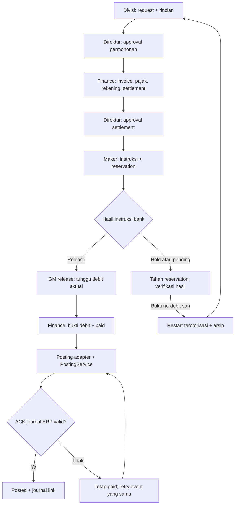
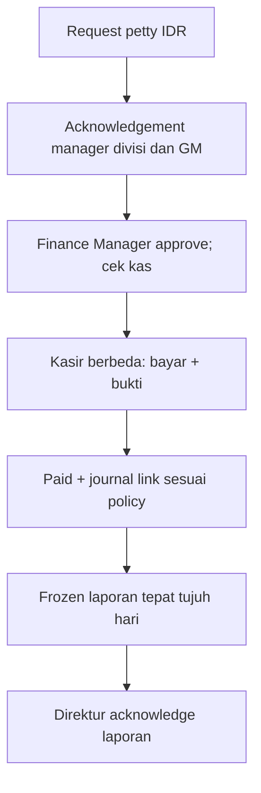
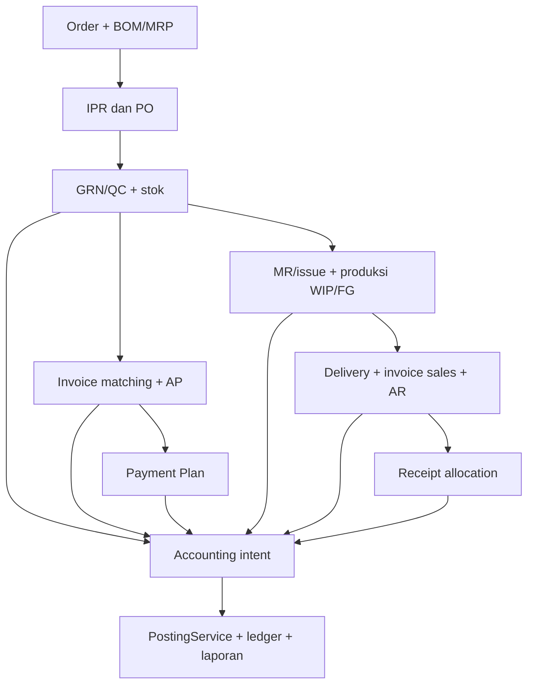
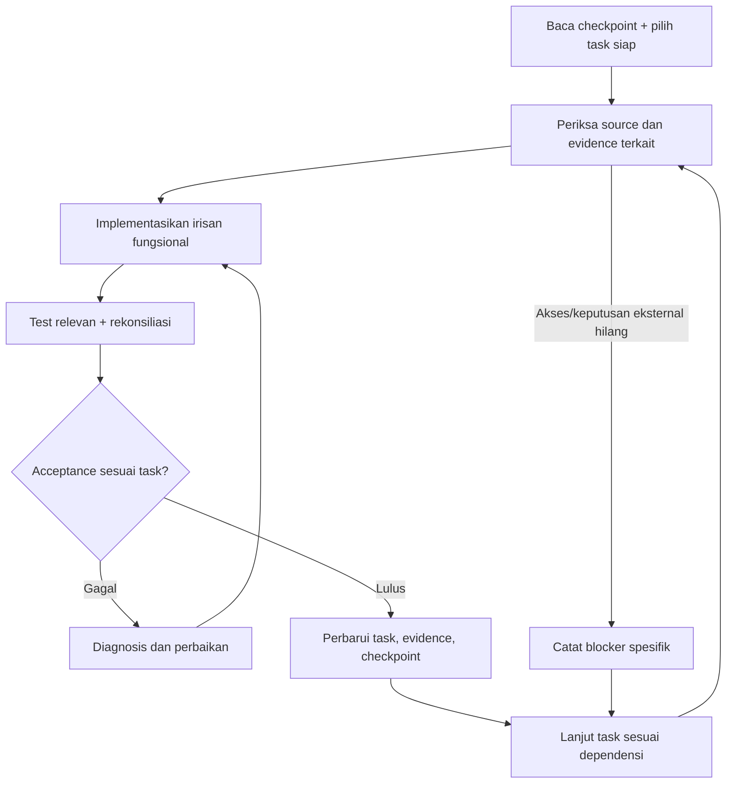

# ERP Marvel-Dard - Master Plan dan Kendali Eksekusi

Versi: 1.1 | Tanggal acuan: 27 Oktober 2026, WIB  
Perusahaan: PT. Magicase Group Indonesia (MGI)  
Branch kerja yang dilaporkan: `feat/marvel-dard-integration`  
Status keseluruhan: **implementasi berjalan; belum siap aktivasi produksi**.

> Dokumen ini adalah panduan utama untuk Cline dan peninjau. Jalankan pekerjaan secara berkelanjutan, dengan checkpoint internal. Ukuran kemajuan adalah alur bisnis yang berfungsi dan bukti acceptance. Jangan meminta pengguna mengetik “lanjut” setelah setiap tugas kecil.

## 1. Cara menggunakan dokumen

1. Tempatkan dokumen ini di `docs/integration/ERP_INTEGRATION_MASTER_PLAN.md` pada repository lokal. Jika sudah ada, gabungkan dengan versi terbaru, jangan menimpa evidence.
2. Baca ringkasan status, checkpoint terakhir, dan hanya rincian tugas aktif beserta dependensinya. Tidak perlu memuat seluruh laporan lama pada setiap iterasi.
3. Cocokkan status dokumen dengan source lokal dan bukti aktual. Dokumen ini dibuat dari laporan pengguna/Cline dalam percakapan; source branch lokal dan hasil test terakhir belum diperiksa ulang saat penyusunan dokumen.
4. Gunakan ID tugas di bawah dalam checkpoint, catatan perubahan, hasil test, dan laporan. Pertahankan ID meskipun urutan pengerjaan berubah.
5. Selesaikan satu irisan bisnis sampai API, layar, jurnal/stock bila relevan, dan bukti pengujiannya tersedia. Lanjutkan irisan berikutnya tanpa menunggu konfirmasi rutin.
6. Perbarui status dan bukti setelah perubahan bermakna. Checkpoint menyimpan langkah berikutnya yang konkret, bukan hanya “lanjutkan integrasi”.

Dokumen ini mengonsolidasikan arah proyek. Referensi sebelumnya tetap dipakai untuk rincian teknis yang tidak bertentangan dengan keputusan terbaru pengguna. Aturan repository aktual tetap diperiksa; jangan menganggap klaim aturan pada prompt lama sebagai isi AGENTS.md yang telah diverifikasi.

## 2. Tujuan dan batas keberhasilan

### Tujuan bisnis

- Mempertahankan akuntansi Marvel-Dard dengan input akun → kode bantu → posisi → nominal, satu PostingService, dan satu ledger ERP.
- Mengambil cakupan operasi Addonan: master, purchasing, inventory, produksi, sales/AR, subkontrak, mekanik, scrap, EXIM, dan pelaporan.
- Mengintegrasikan flow, struktur, form dan kontrol Payment Plan v33 ke identitas, data dan jurnal ERP.
- Memakai Filament + Livewire untuk dashboard, master dan tabel operasional; komponen khusus hanya bila diperlukan.
- Memastikan setiap nilai penting dapat ditelusuri dari layar/laporan ke dokumen sumber dan event ledger.

### Definisi hasil akhir

Integrasi selesai untuk scope yang disepakati bila seluruh requirement mempunyai disposition, alur yang diaktifkan memenuhi acceptance, rekonsiliasi dan restore staging terbukti, dan paket release siap ditinjau. Fitur yang ditunda harus memiliki keputusan scope eksplisit; jangan mengecilkan scope diam-diam untuk membuat status selesai.

Deployment dan aktivasi produksi merupakan keputusan operasional terpisah. Dokumen ini mengotorisasi kelanjutan implementasi dan pengujian dev/staging, bukan transfer bank atau penulisan transaksi produksi.

## 3. Baseline terbaru yang dilaporkan

| Area | Kondisi terakhir | Batas bukti |
|---|---|---|
| Framework | Laravel 12.70.1; PHP 8.2.12 | Versi dari laporan lokal; verifikasi CLI/web saat eksekusi |
| UI baru | Filament 5.11.0 / Livewire 4.4.8; `/erp-panel` | Panel dan master divisi tersedia; browser acceptance belum lengkap |
| UI akuntansi | Akun → kode bantu → posisi → nominal | Dipertahankan; manual journal sudah melalui PostingService |
| Domain v33 | Seluruh 17 aksi; clock; saldo/snapshot/helpers | Oracle 66/66 dan port PHP dilaporkan cocok; domain parity bukan acceptance aplikasi |
| Bank IDR | Jasa langsung dan AP parsial berdasarkan `purchaseBillId`, dari request sampai journal ERP | HTTP development; SQLite in-memory; belum MySQL/browser |
| Pembayaran contoh | AP Rp200,50; bank awal Rp500,00; bayar Rp100,25; bank akhir Rp399,75; residual AP Rp100,25 | Fixture sintetis; tidak membuktikan DP/pajak/fee/USD atau rekonsiliasi penuh AP legacy |
| Posting gagal | Mapping tidak ada → 409, tetap paid, tanpa journal; retry berhasil setelah fixture diperbaiki | Perlu crash/retry dan concurrency MySQL |
| Reservation | Dana dan allocation AP: reserve/consume; validasi invoice/jurnal sumber dan lock residual | Writer di luar financial fence belum tersatukan; MySQL concurrency belum dibuktikan |
| Attachment | Privat, MIME/size/count/hash/role/stage/version/download | Lifecycle lengkap dan storage nyata staging belum terbukti |
| Saldo ERP | Proyeksi membaca GL existing dengan cutoff; receipt GL tidak ditambah settings; paid belum posted diperhitungkan sekali; journal intent ditemukan saat ACK kosong | Implementasi teruji pada fixture SQLite; rekonsiliasi GL/subledger/statement staging belum dijalankan |
| Dependency security | Composer audit 0 advisory; NPM audit 0 vulnerability dilaporkan | Snapshot pada waktu audit, bukan jaminan permanen |
| Build | Vite existing berhasil pada checkpoint sebelumnya | Jalankan ulang bila perubahan asset/dependency memengaruhinya |
| Regression terbaru | Terarah 5 test / 88 assertion; full 719 test / 14.646 assertion; oracle 66/66; syntax/diff lulus | Angka dari laporan Cline; seluruh test DB SQLite in-memory; bukan run baru penyusun dokumen |
| Flag | Default off; database pengguna belum dimigrasi | Flag-on acceptance dilakukan di dev/staging terisolasi |

Route yang dilaporkan tersedia: `/payment-plan/bank`, `/payment-plan/api/data`, `/request`, `/action`, `/attachment` dan download attachment di prefix API tersebut. Verifikasi route aktual; jangan menganggap semua endpoint v33 sudah tersedia.

Status menu terakhir yang memiliki rincian (belum diperbarui oleh laporan AP parsial): 132 unmapped, 9 reuse-candidate, 6 mapped-not-implemented, 3 heading, 1 implemented-pending-acceptance, 0 verified. Total 151. Belum ada laporan count baru setelah ekstensi AP; jangan menebak perubahan status menu dari penambahan test.

### 3.1 Delta v1.1: AP parsial dan saldo GL

Sumber update: laporan pengguna/Cline tentang `docs/integration/erp-bank-ap-extension.md`. Source lokal, file tersebut dan hasil run belum diperiksa ulang oleh penyusun. Status dicatat sebagai **reported implementation**, bukan VERIFIED.

| Bukti HTTP AP | Expected/actual yang dilaporkan |
|---|---|
| Bank awal ERP | Rp500,00 |
| Invoice AP | Rp200,50 |
| Pembayaran parsial | Rp100,25 |
| Bank setelah posting | Rp399,75 |
| Residual AP | Rp100,25 |
| Jurnal | Mendebit utang existing; tidak mengulang expense/PPN invoice |
| Jalur | Approval → attachment privat → settlement → maker/GM → actual debit → PostingService |

Implementasi baru:
- GL ERP menjadi otoritas proyeksi saldo bank dengan cutoff eksplisit.
- Receipt yang sudah di GL tidak dihitung lagi dari settings.
- Debit aktual yang belum diposting menurunkan saldo tersedia; setelah posting terdeteksi tidak dikurangi kedua kali.
- Journal dapat dideteksi melalui stable posting intent ketika ACK aplikasi belum tersimpan.
- AP dipilih melalui `purchaseBillId`, invoice dan jurnal sumber divalidasi, residual dikunci dan allocation di-reserve/consume.
- API menyediakan kandidat AP dan breakdown GL/pending debit/reservation/available untuk role finansial.
- Workbench development mempunyai selector AP; UI referensi v33 dan cetaknya belum diadaptasi.

Batas penting:
- Simulasi ACK kosong memakai kondisi tersimpan; **bukan crash proses nyata**.
- Residual belum mencakup seluruh pembayaran manual/legacy, retur dan credit note.
- Writer lain yang tidak memakai financial fence masih harus disatukan.
- DP/progress/final/retention, USD dan petty belum didukung pada runtime operasional baru. Domain parity yang tersedia tidak sama dengan dukungan runtime.
- MySQL concurrency, browser/mobile, physical private storage staging, rekonsiliasi aktual dan restore belum dijalankan. Flag tetap off; produksi tidak disentuh.

### 3.2 Checkpoint kelanjutan yang aktif

**M1 tetap IN_PROGRESS.** Jangan membuat ulang sumber saldo GL atau AP parsial. Lengkapi rekonsiliasi, writer coverage dan UI/acceptance yang belum tersedia.

1. F04/F11: telusuri sumber residual AP; gabungkan allocation baru dengan pembayaran manual/legacy, retur dan credit note yang sah tanpa double count. Simpan provenance kontribusi dan exception; kasus yang belum terselesaikan tidak boleh dinyatakan aman dibayar.
2. F03/B02: inventaris semua writer yang mengubah dana/residual; arahkan ke fence/use case atau pasang guard terkoordinasi. Lock yang hanya dipakai Payment Plan tidak dapat melindungi dari writer di luar jalur.
3. U02-U04/U06: adaptasikan UI v33 dan cetak pada service/API yang sama. Expose breakdown saldo/AP secara authorized; dashboard/inbox Filament memakai query nyata. Jangan menjadikan selector workbench sebagai akhir pekerjaan UI.
4. Q03/F10: bangun race test MySQL dan crash/recovery nyata. Bedakan process crash dari exception rollback atau simulasi ACK kosong.
5. F05 dan milestone berikutnya: lanjutkan DP/progress/final/retention, kemudian USD/petty/legacy/operasi menurut dependensi. Pekerjaan independen tidak perlu menunggu pengguna mengetik lanjut.

## 4. Keputusan arsitektur yang mengikat

| ID | Keputusan | Implikasi implementasi |
|---|---|---|
| A01 | Satu PostingService dan ledger | Modul mengirim accounting intent; tidak menulis jurnal lewat CRUD generik |
| A02 | Reuse master/service/GRN existing | Tidak membuat company, party, receiving atau saldo paralel |
| A03 | Single-company MGI dahulu | Foreign-company access ditolak; multi-tenant operasional bukan prasyarat |
| A04 | Domain Payment Plan tetap terpisah dari I/O | Policy, persistence, clock dan presentation memakai adapter |
| A05 | Filament adalah lapisan presentasi | Action memanggil use case ERP; hidden button bukan otorisasi |
| A06 | UI referensi v33 tetap target Payment Plan | Workbench adalah jembatan pengembangan; hindari dua UI final dengan workflow terpisah |
| A07 | Bootstrap lama dan asset panel terisolasi | Hindari konflik Tailwind/Bootstrap, Alpine ganda, submit ganda dan DOM ownership ganda |
| A08 | Posted immutable; koreksi tertaut | Reversal/replacement menjaga jejak sumber; tidak edit/hapus posted |
| A09 | Stable payment-event ID | Retry, lampiran dan perubahan version request tidak membuat journal key baru |
| A10 | Historical terpisah dari operational | Tidak membuat approval palsu atau mengurangi saldo lagi; paid-unposted tetap direkonsiliasi |
| A11 | Mapping/mandat belum sah membatasi aktivasi terkait | Implementasi resolver/fixture dan pekerjaan independen tetap berjalan |
| A12 | Semua migration additive dan backward-compatible | Tidak reset/drop database pengguna; restore lama bukan rollback setelah ada transaksi baru |

## 5. Flow kerja produk

### 5.1 Bank



Release GM tidak otomatis paid. Hold/pending/failed tidak otomatis melepas reservation. Return sebelum instruksi mengikuti domain; perubahan setelah instruksi aktif memerlukan verifikasi pembatalan/no-debit. Transaksi belum didukung ditolak secara eksplisit, bukan dialihkan menjadi beban biasa.

### 5.2 Kas kecil



Top-up bank tidak langsung menjadi penerimaan kas fisik. Gunakan in-transit lalu receipt kas yang tertaut sekali. Fee bank tidak menambah kas. Laporan frozen tidak ditimpa; koreksi memakai amendment/reconciliation.

### 5.3 Operasi dan pembukuan



Panah intent menunjukkan jalur integrasi, bukan bahwa setiap dokumen langsung diposting pada saat dibuat. Trigger pengakuan, akun dan costing mengikuti kebijakan yang sah dan status dokumen.

## 6. Flow kerja pelaksanaan



- Jangan ulang discovery seluruh repo, audit penuh, atau suite penuh tanpa perubahan/risiko yang membenarkannya.
- Kegagalan pada satu modul menahan pekerjaan yang bergantung padanya; pekerjaan independen tetap berjalan.
- Jika konteks habis, simpan task aktif, perubahan, test terakhir, blocker dan next action. Lanjutkan dari sana.
- Update singkat menjelaskan fitur yang bertambah, bukti dan masalah; bukan permintaan izin rutin.

## 7. Status tugas dan evidence

| Status | Makna |
|---|---|
| `TODO` | Belum ada implementasi yang diketahui |
| `IN_PROGRESS` | Ada bagian berjalan; acceptance belum lengkap |
| `IMPLEMENTED` | Kode/route tersedia dan test relevan lulus; acceptance lain masih kurang |
| `VERIFIED` | Seluruh kriteria task dan evidence wajib terpenuhi pada lingkungan yang ditentukan |
| `BLOCKED` | Ada blocker spesifik; reason, owner keputusan, dampak dan pekerjaan alternatif tercatat |

Status awal di tabel berikut adalah **berdasarkan laporan**, bukan pemeriksaan ulang source oleh penyusun. Naikkan ke VERIFIED hanya setelah menautkan bukti. Heading/menu alias mempunyai disposition tersendiri; tidak dihitung sebagai fungsi transaksi baru.

Untuk setiap task, simpan:

```yaml
task_id: F01
status: IN_PROGRESS
source_state: reported_by_cline
source_ref: commit SHA aktual atau patch/checkpoint digest bila belum commit
changed_files: []
routes_or_commands: []
tests: []
environment: dev atau staging; driver dan storage aktual
expected: kriteria task
actual: hasil teramati
evidence: path hasil test, reconciliation atau catatan review
blocker: null
next_action: aksi spesifik yang bisa dikerjakan
updated_at: waktu WIB aktual
```

Jangan membuat commit hanya untuk mengisi field source_ref. Working tree yang belum bersih harus dipertahankan dan dapat dibuktikan melalui diff/checkpoint.

## 8. Backlog terukur

### Fondasi dan akuntansi

| ID | Tugas | Status awal | Dependensi | Kriteria selesai |
|---|---|---|---|---|
| B01 | Kontrak UI/jurnal aktual dan source map | IMPLEMENTED | - | Source writer, shape input, normal balance, akun bantu dan evidence baseline tercatat |
| B02 | Idempotency accounting lintas modul | IN_PROGRESS | B01 | Key/hash stabil; parallel retry menghasilkan satu journal; konflik payload ditolak tanpa partial write |
| B03 | Immutable posted + linked reversal | IN_PROGRESS | B01 | Edit/delete semua jalur ditolak; reversal tertaut seimbang; laporan original+reversal benar |
| B04 | Period lock seluruh writer | IMPLEMENTED | B01 | UI/API/import/service mematuhi periode; close/reopen policy dan audit terbukti, termasuk flag |
| B05 | Regression laporan dan relasi aset | IN_PROGRESS | B02-B04 | Saldo awal, lintas bulan/tahun, normal kredit, detail ID aset, GL/P&L/neraca dan FX tidak rusak |

### Pembayaran dan saldo

| ID | Tugas | Status awal | Dependensi | Kriteria selesai |
|---|---|---|---|---|
| F01 | Sumber saldo ERP dan cutoff | IMPLEMENTED | B01 | GL+cutoff/pending-debit dedup teruji SQLite; VERIFIED memerlukan rekonsiliasi subledger/statement staging, cutoff boundary dan setiap source tepat sekali |
| F02 | Bank jasa IDR end-to-end | IMPLEMENTED | Domain dan WorkflowStore existing | Request sampai ACK journal; mapping hilang tetap paid; retry tidak menggandakan; evidence HTTP tersedia |
| F03 | Reservation dan locks shared invariant | IN_PROGRESS | F01-F02 | Funds/AP locks tersedia untuk alur baru; satukan writer luar fence; dua maker/residual race aman MySQL, hold tidak release, lock order konsisten |
| F04 | AP invoice by ID dan partial payment | IN_PROGRESS | F01-F03, purchase/AP existing | Partial `purchaseBillId` HTTP teruji; lengkapi residual manual/legacy/retur/credit note, source trace dan cross-account race MySQL; tidak expense/VAT ulang |
| F05 | DP, progress, final, retention | TODO | F04 | Advance lifecycle/alokasi tertaut; residual kontrak benar; pembatalan/return dan reversal terkontrol |
| F06 | Pajak, fee dan multi-account allocation | TODO | F04-F05, mapping sah | Gross/net/debit konsisten; allocation balance; payable withholding dan fee tertelusur; fixture bukan tarif produksi |
| F07 | USD dan FX | TODO | F01, currency model, F04 | Native/base amounts dan rounding tepat; realized FX tertaut; tidak menganggap nama akun membuktikan currency nilai |
| F08 | Petty dan top-up | IN_PROGRESS | F01-F03 | Domain tersedia, runtime baru belum didukung; implementasikan dua ack/approver/pembayar, receipt top-up sekali, in-transit dan fee |
| F09 | Weekly frozen + amendment | IN_PROGRESS | F08 | Tepat tujuh hari selesai; tidak overlap; physical count/variance; backdate diselesaikan lewat amendment |
| F10 | Stable-event posting dan recovery | IN_PROGRESS | B02, F02-F03 | Intent detection saat ACK kosong telah disimulasikan; buktikan crash proses setelah journal commit, recovery journal yang sama, posted hanya ACK valid |
| F11 | Konvergensi legacy | TODO | F04-F10 sesuai tipe transaksi | Rekonsiliasi residual manual/legacy menjadi prasyarat keamanan AP; kemudian ownership/cutover satu writer dan paid-unposted reconciled |

### API, attachment, UI, dan Filament

| ID | Tugas | Status awal | Dependensi | Kriteria selesai |
|---|---|---|---|---|
| U01 | Panel Filament dan master divisi | IMPLEMENTED | Identity/policy existing | Sesi ERP, policy, flag, service/audit; browser dan reactive access tests lengkap |
| U02 | Kontrak API v33 lengkap | IN_PROGRESS | Domain, persistence, F tasks terkait | Endpoint per fungsi terdaftar; 401/403/409/419/422/429 dan field shape benar; aksi unsupported ditolak |
| U03 | Lifecycle attachment privat | IN_PROGRESS | U02 | Upload/retry/archive/download per stage; MIME/hash/limit; storage nyata, orphan reconciliation dan recovery |
| U04 | UI referensi v33 dan cetak | TODO | U02-U03 dan F tasks terkait | Semua view/form/aksi yang didukung memakai API sah; 49 referensi URL ditangani; mobile, foto dan multi-page print lulus |
| U05 | Comments dan notifications | TODO | U02-U03 | Context request/line/blob, mentions authorized, dedup key dan read state; tidak mengubah workflow |
| U06 | Dashboard/inbox Filament | IN_PROGRESS | Query sumber/F01/U02 | Data nyata per role/currency; count cocok drill-down; tidak membuat saldo rekaan |
| U07 | Master dan tabel operasional Filament | IN_PROGRESS | Model/service existing, O tasks | Master aktif mempunyai policy/service/evidence; relation lookup/global search/export tidak bocor |
| U08 | Import/export aman | TODO | U02-U04 | Preview no-write, commit atomic, limits/dedup, formula protection; export seluruh filter dengan count/totals cocok |

### Operasi Addonan

| ID | Tugas | Status awal | Dependensi | Kriteria selesai |
|---|---|---|---|---|
| O01 | Crosswalk master dan varian/unit | IN_PROGRESS | B01, U07 | Source rows terhitung; unresolved explicit; warna/ukuran desimal utuh; unit conversion >0; master tidak duplikat |
| O02 | IPR/PO/amendment/tracking | TODO | O01 | Line-source links, residual, approval, MOQ bila relevan dan perubahan versi tidak menulis ulang histori |
| O03 | GRN/QC/retur/invoice/AP | IN_PROGRESS | GRN A3 existing, O02, B02 | Partial/over-receipt tolerance, quarantine, three-way match, retur dan AP/stock/GL cocok |
| O04 | Inventory/MR/issue/transfer/opname | TODO | O01-O03 | Ledger mutasi tunggal; qty conservation; issue paralel aman; transfer dua kaki/in-transit; opname disetujui |
| O05 | BOM/MRP/WO/routing/WIP/FG | TODO | O04 | Version snapshot, shortage, actual issue, yield/rework/scrap dan close variance tertelusur |
| O06 | Sales/delivery/invoice/AR/receipt | TODO | O04-O05, B02 | Dokumen fisik/tagihan/uang terpisah; partial/return/receipt allocation; AR aging cocok GL |
| O07 | Subkontrak/mekanik/scrap/aset | TODO | O04-O06 sesuai alur | Ownership/location terpisah; material balance, serial/set value, scrap/disposal dan asset links tepat |
| O08 | EXIM/BC/MIS/trace reports | TODO | O03-O07 sesuai report | Type+direction jelas; staging import, tujuh laporan trace, reconciliation; tidak klaim H2H dari menu import |

### Acceptance dan release

| ID | Tugas | Status awal | Dependensi | Kriteria selesai |
|---|---|---|---|---|
| Q01 | Regression, build dan dependency audit | IMPLEMENTED | Perubahan terkait | Evidence actual dan lockfile diketahui; perbaiki temuan baru; angka lama tidak dipakai sebagai run baru |
| Q02 | Browser/mobile/print/reactive security | IN_PROGRESS | U01-U08 sesuai halaman | Akses/aksi/tampilan pada desktop dan 360/390/768 px; matriks role/ID tampering/session/CSRF diverifikasi |
| Q03 | MySQL concurrency dan crash recovery | TODO | B02, F03-F10, O04 | Dua proses/transaksi nyata; invariant tetap benar, retry deterministik; driver/storage dinyatakan |
| Q04 | Migration, rekonsiliasi dan restore | TODO | Modul target siap | Dry-run reproducible; source=accepted+quarantine+excluded; DB+blob restore cocok hash/control totals |
| Q05 | Release pack dan keputusan aktivasi | TODO | Acceptance modul yang diaktifkan | Release manifest, flags, unresolved risks, PIC, cutover/rollback dan sign-off konkret; belum deploy |

TODO pada modul operasi berarti perluasan integrasinya belum dibuktikan dalam laporan terakhir, bukan pernyataan bahwa repository tidak memiliki model/service terkait. Discovery terarah harus mencari reuse terlebih dahulu.

## 9. Urutan kerja dan milestone

| Milestone | Hasil yang dapat diperagakan | Task utama | Gerbang objektif |
|---|---|---|---|
| M1 | Bank IDR/AP pada saldo ERP melalui UI v33 | F01-F04, F06/F10 sesuai tipe, U02-U04 | IN_PROGRESS: GL dan partial AP HTTP tersedia; residual legacy/retur/credit note, seluruh writer, UI v33 dan MySQL/browser acceptance belum lengkap |
| M2 | Pembayaran lengkap dan legacy terhubung | F05-F11, U05-U08 | DP/retention/USD/petty sesuai scope; frozen reports; legacy ownership; tidak double balance/journal |
| M3 | Purchasing sampai inventory | O01-O04, U07 | PO→GRN→invoice/AP→payment dan stock movement trace; qty/value/GL cocok |
| M4 | Produksi dan fulfilment | O05-O07 | Material balance, WIP/FG, delivery/AR/receipt, subkontrak/scrap tertelusur |
| M5 | EXIM dan MIS lengkap | O08, U08 | Laporan/trace/import/reconciliation dan source totals cocok |
| M6 | Paket siap ditinjau untuk aktivasi | Q01-Q05 seluruh scope aktif | Acceptance, restore dan sign-off lengkap; flags rilis eksplisit |

M1 harus diselesaikan sebagai alur utuh, bukan proyek backend saja lalu UI jauh belakangan. Pekerjaan UI/query/master yang tidak bergantung pada perubahan saldo boleh berjalan bersamaan secara logis, tanpa mengharuskan sub-agent atau merge paralel.

Target tanggal belum ditetapkan karena durasi implementasi dan ketersediaan staging belum diukur. Saat milestone mulai, catat target dan asumsi kapasitas; revisi berdasarkan bukti, bukan janji tanggal tanpa dasar. Ukur durasi mulai/selesai dan waktu terblokir.

## 10. Kriteria teknis inti

### Saldo dan reservation

- Satu otoritas saldo dan cutoff per rekening/currency; opening tidak dihitung lagi dari detail historis yang sudah tercakup.
- Actual balance terpisah dari available funds. Available = actual minus active reservations sesuai scope waktu.
- Confirm paid mengonsumsi reservation sekali dan mengakui debit sekali. Retry tidak menambah mutasi.
- Ledger projection membedakan opening, GL movement, actual debit yang belum journal, active reservation dan intent journal tanpa ACK; satu event tidak boleh berada di dua pengurang saldo.
- Residual AP dihitung dari sumber liability/credit dan allocation yang sah pada cutoff yang sama. Pembayaran manual/legacy serta retur/credit note wajib diperhitungkan dengan source identity; bukan sekadar invoice amount minus allocation baru.
- No-debit terverifikasi dapat melepaskan reservation; hold/pending/failed saja tidak cukup.
- Account locks tidak menggantikan invoice/contract residual locks. Lock order global dan bounded retry harus terdokumentasi.

### Posting dan accounting

- Key event stabil + canonical payload hash + unique constraint + journal link, bukan request version yang berubah.
- Mapping kosong atau invalid menolak posting dengan error yang dapat ditindaklanjuti; status paid tetap paid.
- Semua jalur menggunakan balance validation, period lock, akun aktif/detail dan company binding yang sama.
- Tidak ada posted palsu hanya karena input journal reference; ACK harus menuju journal ERP yang sah.
- Invoice, payment, advance allocation, fee, withholding dan FX mempunyai peran pengakuan berbeda; hindari penggandaan beban/pajak.

### UI dan keamanan

- Filament/Livewire public state diperlakukan sebagai input tidak tepercaya. Ambil ulang record, actor dan authoritative totals dalam use case.
- Permission/resource/state/version diperiksa pada setiap aksi, termasuk setelah mount. ADMIN tidak otomatis memiliki role transaksi.
- Generic create/update/delete/bulk/inline/relationship action tidak boleh melewati service ERP.
- UI v33 dan Livewire tidak mengelola DOM yang sama tanpa lifecycle jelas. Default gunakan halaman Blade dedicated + navigasi panel.
- Semua lookup/search/stats/export/download memakai scope yang konsisten. Jangan hanya mengamankan list utama.
- User inactive belum terbukti sebagai schema fitur; jangan menyamakan company inactive dengan user inactive. Temukan sumber status user yang sah sebelum implementasi/review tersebut.

## 11. Matriks pembuktian

| Kode | Lingkungan | Membuktikan | Tidak menggantikan |
|---|---|---|---|
| E-DOM | Pure PHP + oracle Node, clock eksplisit | Aturan domain dan proyeksi | DB, API, browser, concurrency |
| E-HTTP | Laravel HTTP, SQLite bila dinyatakan | Routing/policy/validation/workflow request | MySQL lock semantics dan UI visual |
| E-LW | Reactive HTTP dengan snapshot sah | Action/security Livewire aktual | Browser rendering/interaksi penuh |
| E-MYSQL | DB uji terisolasi; dua proses untuk race | Transaction/lock/unique/retry sesuai driver | Rekonsiliasi data staging bisnis |
| E-FILE | Private storage nyata staging | Upload/download/archive/recovery | Disk fake atau source ZIP bukan pengganti |
| E-UI | Browser desktop/mobile/cetak | Layout, role interaction, navigation, print | Assertion status HTTP saja |
| E-REC | Dataset staging + control totals | AP/AR/stock/cash/GL/source agreement | Suite hijau tanpa data rekonsiliasi |
| E-RESTORE | Restore DB + objects pada staging | Recovery lengkap dan integritas | Git/source ZIP saja |

Setiap hasil mencatat environment, perintah/skenario, expected, actual, pass/fail/skip, tanggal, source ref dan evidence. Jika belum dijalankan, tulis NOT RUN dan alasan, bukan PASS.

## 12. Dashboard pengukuran proyek

| Ukuran | Cara menghitung | Target |
|---|---|---|
| Cakupan requirement | Requirement dengan disposition dan evidence / scope yang disepakati | Semua tercatat; tidak silent drop |
| Alur VERIFIED | Skenario bisnis lengkap yang lulus acceptance / skenario wajib | Semua skenario modul yang akan diaktifkan |
| Menu | Count per status, total tetap 151 source ID | Tidak mempromosikan alias/heading menjadi fitur selesai |
| Ketepatan journal | Jurnal ganda, orphan detail, paid-unlinked unresolved | Nol untuk dataset acceptance yang dinyatakan |
| Reservation | Overdraw/over-allocation/lost update pada race test | Nol pelanggaran invariant |
| Rekonsiliasi | Selisih qty/native/base/GL yang tidak dijelaskan | Nol selisih tidak terjelaskan |
| Data migration | Source - accepted - quarantine - excluded-with-reason | Nol |
| Evidence coverage | Task VERIFIED dengan seluruh evidence wajib | 100% task VERIFIED |
| Security | Advisory terbuka dan authorization failures | Tidak ada risiko release yang belum diselesaikan/diterima secara eksplisit |
| Waktu | Cycle time milestone dan blocked duration | Diukur aktual, tanpa mengarang estimasi |

Jangan memberikan persentase penyelesaian keseluruhan dari jumlah test atau jumlah menu saja. Jika dibutuhkan, tetapkan denominator requirement dan bobot yang disepakati terlebih dahulu. Penambahan assertion tidak otomatis meningkatkan progress bisnis.

## 13. Tanggung jawab

| Peran | Tugas | Batas klaim |
|---|---|---|
| Cline pada repository lokal | Coding, dependency, tests, dev/staging, evidence dan checkpoint | Hanya melaporkan command dan hasil yang benar-benar dijalankan |
| Asisten/peninjau | Menjaga arsitektur, menilai bukti, koreksi scope, acceptance dan prompt | Tidak mengklaim telah mengubah drive D: atau source lokal tanpa akses |
| FAT Manager/Finance | Kebijakan COA, saldo/cutoff, SoD, invoice/advance dan reconciliation approval | Penugasan orang aktual perlu dicatat; jangan memalsukan approval |
| Warehouse/PPIC/Production/EXIM | Material/unit, routing/yield, ownership, BC/report verification | Keputusan domain belum ada masuk decision log |
| IT/operator staging | Akses DB/blob, restore, deployment packaging, concurrency environment | Production cutover perlu otorisasi operasional |

Nama PIC individual belum ditetapkan. Dokumentasikan penanggung jawab nyata saat tersedia; role di tabel bukan tanda bahwa orang tertentu sudah menyetujui.

## 14. Blocker, keputusan dan batas tindakan

### Bukan alasan menghentikan seluruh pengembangan

- Browser/MySQL/storage belum tersedia: siapkan test/runbook, kerjakan fitur independen; acceptance terkait tetap terbuka.
- Mapping atau mandat belum sah: siapkan resolver/fixture dan gate aktivasi, lanjutkan domain/UI independen.
- Working tree berisi perubahan pengguna: lindungi dan kerjakan diff terarah, jangan reset.
- Satu test gagal: diagnosis akar masalah; pekerjaan dependent menunggu, yang independen dapat lanjut.

### Catatan blocker wajib

`ID; task; fakta/error; langkah reproduksi; dampak; keputusan/akses yang hilang; role pemilik; next action; alternatif yang dikerjakan; tanggal`.

AGPO, trigger WIP, metode costing dan mandat rekening tidak boleh ditentukan dari tebakan nama menu atau prompt lama. Jangan menganggap format COA enam digit sebagai syarat semua account ERP bila schema aktual berbeda.

### Batas operasional

- Tidak reset/drop/truncate/migrate:fresh database pengguna, menghapus transaksi, memulihkan penghapusan file pengguna, atau mengubah master/mandat/secret produksi melalui instruksi ini.
- Migration dan seed fixture hanya pada dev/test/staging terisolasi yang sudah dibuktikan targetnya.
- Tidak deploy/merge/push/commit otomatis; Git actions mengikuti otorisasi yang berlaku pada repository.
- Flag default off pada produksi; flag-on acceptance wajib diuji di staging.
- Tidak melakukan transfer bank, approval bank nyata atau submit CEISA nyata.
- Jangan melemahkan guard, expected result atau parser agar test hijau.

## 15. Release dan rollback

Go untuk suatu modul hanya bila acceptance-nya lengkap, dependencies siap, data/currency/mapping/mandat sah, restore DB+blob terbukti, unresolved risks ditinjau, dan operator menerima paket konkret.

Urutan paket cutover: source/lockfile manifest → freeze terukur → backup DB+blob → deploy kompatibel → delta migration → reconciliation → canary → monitoring → pembukaan pengguna bertahap.

Sebelum transaksi baru, rollback dapat menggunakan flag dan aplikasi yang kompatibel schema. Setelah transaksi baru, jangan restore backup lama tanpa menjaga delta. Hentikan writer, arsipkan delta dan bukti, reconcile, lalu forward-fix atau recovery/replay yang disetujui. Reversal finansial tetap tertaut.

Monitor minimal: journal duplicate, paid tanpa link, outbox gagal/pending, reservation tertahan, residual overpaid, stok negatif, orphan object dan report mismatch. Ambang waktu operasional/SLA ditetapkan operator, bukan dikarang di dokumen ini.

## 16. Dokumen kendali yang dipelihara

Semua path relatif berikut berada di `docs/integration/`:

| Dokumen | Fungsi |
|---|---|
| `ERP_INTEGRATION_MASTER_PLAN.md` | Scope, task ID, dependency, acceptance dan arah utama |
| `execution-checkpoint.md` | Source aktual, task aktif, hasil terakhir, blocker dan next action |
| `test-evidence.md` | Command/skenario dan hasil aktual dengan lingkungan |
| `decision-log.md` | Keputusan sah, dasar, dampak, opsi tertolak dan tanggal |
| `menu-map.csv` | 151 source ID, canonical mapping, presentation, status dan evidence |
| `data-map.md` | Master/source/target ID, ownership dan migration crosswalk |
| `bank-flow-development.md` | Perilaku bank yang sudah ada dan gap aktual |
| `erp-bank-ap-extension.md` | Proyeksi saldo GL, partial AP by ID, HTTP fixture dan batas residual/fence/ACK simulation |
| `merged-v33-method.md` | Oracle, provenance fixture dan legacy/hardened delta |
| `filament-livewire-adoption.md` | Panel, auth, assets, version dan Resource→service mapping |
| `dependency-security-triage.md` | Audit snapshot, update terarah dan unresolved security |
| `rollback.md` | Langkah pembatalan/recovery konkret sesuai perubahan |

Hindari membuat dokumen baru untuk setiap beberapa transisi. Update task/evidence pada dokumen kendali ini. Dokumen bukti besar dapat dipisah dan ditautkan.

## 17. Template laporan kemajuan

```markdown
Tanggal/source ref:
Milestone/task aktif:

Alur yang bertambah dan dapat diperagakan:
- [task ID] perubahan perilaku + route/layar + service sumber.

Bukti baru:
| Task | Lingkungan | Skenario/perintah | Hasil | Evidence |
|---|---|---|---|---|

Rekonsiliasi:
- Dataset, cutoff, count/qty/native/base/GL; selisih dan penjelasan.

Status requirement/menu:
- Count aktual dan perubahan sejak laporan sebelumnya; tidak ada klaim verified tanpa evidence.

Blocker:
- ID, fakta, dampak, owner keputusan dan pekerjaan alternatif.

Next action yang langsung dikerjakan:
- Task ID + aksi konkret + acceptance yang dituju.
```

## 18. Instruksi mulai untuk Cline

```text
Baca master plan v1.1, checkpoint terbaru dan erp-bank-ap-extension.md.
Pertahankan branch feat/marvel-dard-integration dan perubahan pengguna.
Jangan mengulang implementasi saldo GL atau partial purchaseBillId yang sudah ada.

Lanjutkan M1 sampai lengkap: audit source residual manual/legacy/retur/credit note,
satukan seluruh writer dana/AP ke kontrol terkoordinasi, adaptasikan UI/cetak v33
serta dashboard/inbox Filament, dan buktikan MySQL concurrency serta storage/browser.

Kerjakan acceptance AP-R01 sampai AP-R10 sebagai bukti objektif.
Jangan menyebut simulasi ACK kosong sebagai crash test proses nyata.
Lanjutkan DP/progress/final/retention dan milestone berikutnya sesuai dependensi;
pekerjaan independen tetap berjalan bila staging atau keputusan spesifik terblokir.

Use case/domain/PostingService existing tetap otoritas. UI matriks tetap.
Catat source ref, file, test, actual result, gap dan next action tiap task.
Checkpoint bukan alasan berhenti atau meminta pengguna mengetik lanjut.
Jangan klaim VERIFIED tanpa bukti. Tidak ada tindakan produksi/transfer bank.
```

### Acceptance lanjutan AP dan saldo (spesifikasi, belum dijalankan)

| ID | Skenario | Hasil wajib |
|---|---|---|
| AP-R01 | Cutoff: transaksi sebelum, pada dan setelah tanggal opening | Tidak overlap opening/movement; saldo cocok sumber dan convention tanggal terdokumentasi |
| AP-R02 | Receipt tercatat di GL dan juga metadata settings | Dihitung sekali; provenance dapat diperiksa |
| AP-R03 | Paid belum journal, kemudian journal/ACK tersimpan | Available selalu benar; transisi tidak menggandakan debit |
| AP-R04 | Journal committed tetapi proses mati sebelum ACK; restart worker/request | Ditemukan lewat intent stabil; satu journal dan satu consumption; evidence termination/restart nyata |
| AP-R05 | Invoice 200,50; manual paid 50,00; allocation baru 100,25 | Residual 50,25 bila semua event sah dan tidak ada penyesuaian lain; manual event tidak dihitung lagi dari GL dan subledger |
| AP-R06 | Retur/credit note sah, void, reversal dan beda currency | Pengaruh residual mengikuti lifecycle dan source yang sah; exception jelas; tidak menjumlah currency berbeda |
| AP-R07 | Dua maker berebut saldo serta satu invoice dibayar dari dua rekening, dua proses MySQL | Tidak melebihi available/residual; konflik ditangani tanpa partial journal/allocation |
| AP-R08 | Writer manual/legacy dan Payment Plan berjalan bersamaan | Fence/lock yang sama atau guard terkoordinasi mencegah bypass; seluruh writer terinventaris |
| AP-R09 | Selector AP, breakdown saldo, approval, bukti dan cetak pada UI v33 | Authorized scope, stale/conflict handling dan mobile/print lulus; workbench bukan evidence UI final |
| AP-R10 | Private disk staging + backup/restore DB/blob + reconcile AP/GL/bank | Hash/file links dan control totals cocok; hasil serta reconciling items terdokumentasi |

Semua AP-R masih NOT RUN pada saat update dokumen ini. Kasus AP-R01-R03 mempunyai implementasi terkait yang dilaporkan; status skenario tetap menunggu evidence spesifik. Nilai AP-R05 adalah rancangan fixture, bukan transaksi tambahan yang telah diuji.

## 19. Riwayat revisi

| Versi | Tanggal | Perubahan |
|---|---|---|
| 1.0 | 27 Oktober 2026 | Konsolidasi flow, 37 task, enam milestone, evidence, ukuran kemajuan dan instruksi berkelanjutan; baseline dilaporkan 716 tests dan bank jasa IDR HTTP end-to-end |
| 1.1 | 27 Oktober 2026 | Update dilaporkan: saldo GL/cutoff dan partial AP purchaseBillId; 719 tests / 14.646 assertions; F01 IMPLEMENTED, F04 IN_PROGRESS; M1 belum lengkap; tambah 10 acceptance AP dan prioritas residual/fence/UI/MySQL |

Saat memperbarui dokumen, catat perubahan status/evidence yang substansial dan jangan mengubah tanggal/angka test lama seolah-olah run baru. Hitung jumlah task dari ID tabel jika scope berubah.
